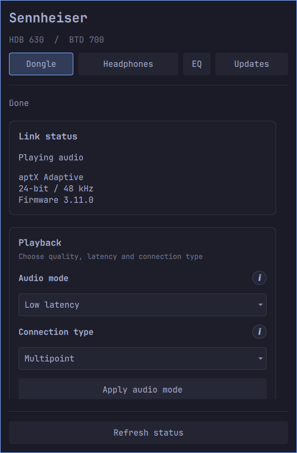
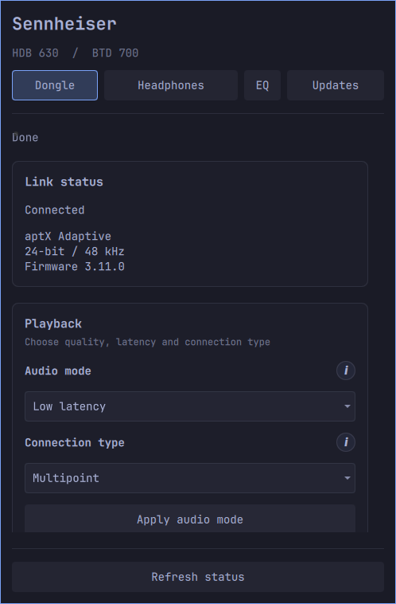
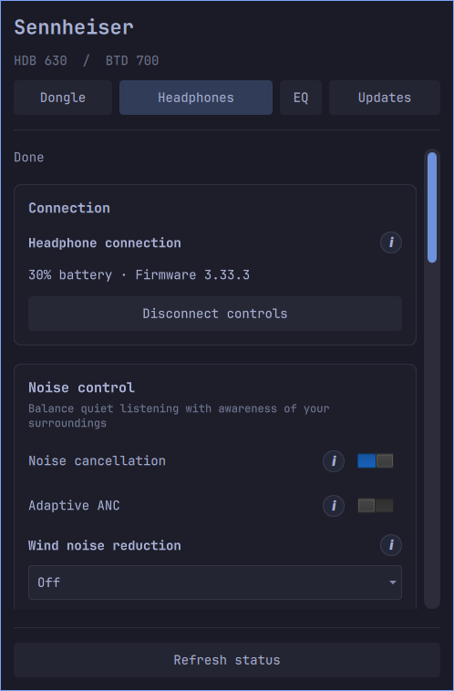
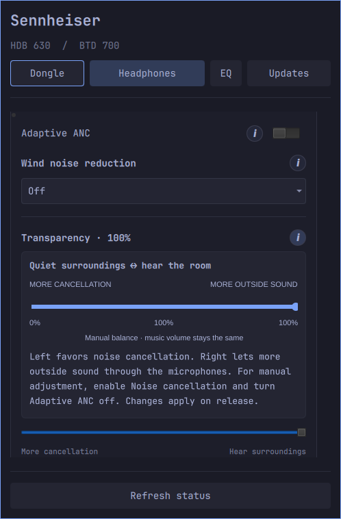
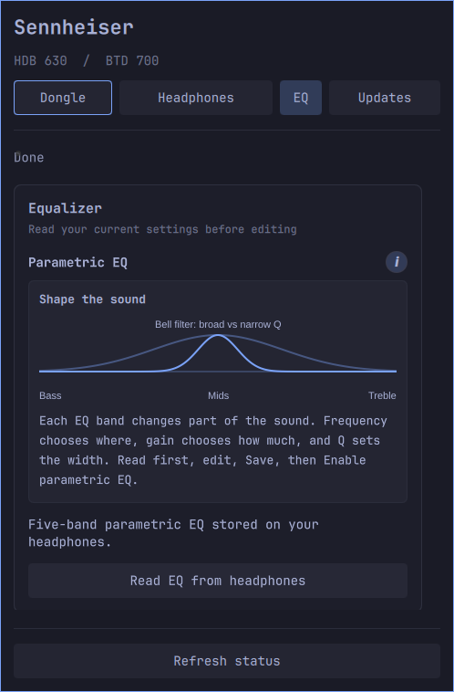
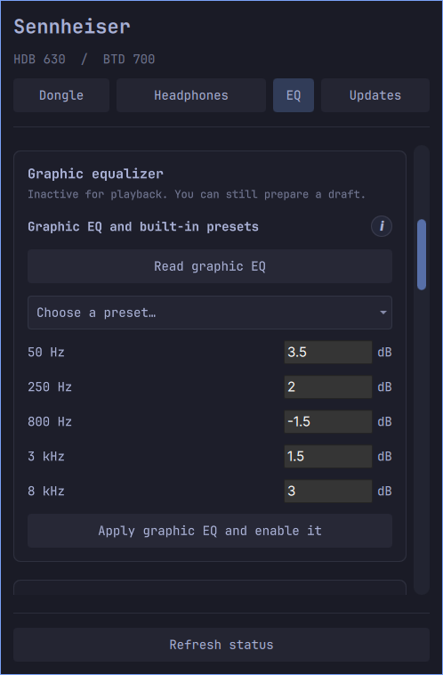
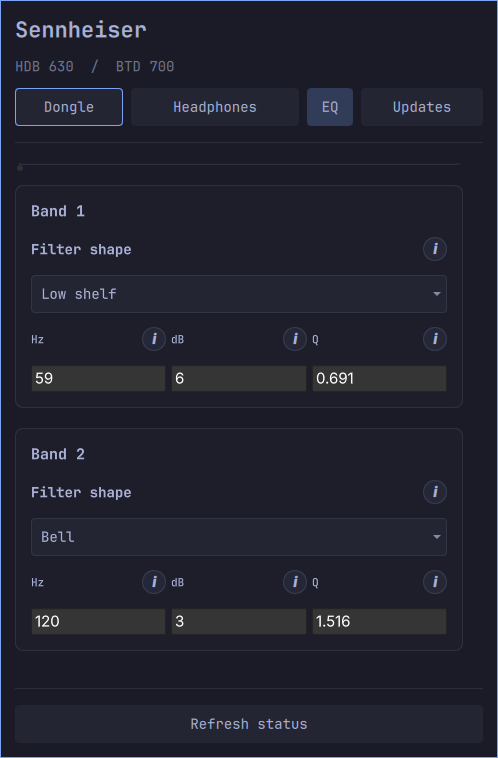
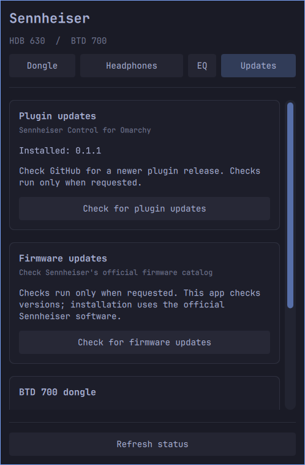

# Screenshots and walkthrough

Real captures of the Omarchy popup with an HDB 630 and BTD 700, using the desktop's
current theme. Only the plugin panel is included. Device addresses, passwords and
other desktop content are excluded.

## Animated walkthrough

The silent, looping WebP shows tab navigation, dragging the visible scrollbar,
scrolling through EQ editors and opening help cards.
No headphone settings were changed while recording. Firmware installation is
not implemented; the Updates tab checks versions and links to official software.

## Screenshots

| Dongle controls | Headphone controls |
| --- | --- |
|  |  |

| Transparency explanation | Parametric EQ explanation |
| --- | --- |
|  |  |

| Graphic EQ | Parametric EQ |
| --- | --- |
|  |  |

Captured on 2026-10-30. Values reflect the connected devices at capture time;
help diagrams are conceptual illustrations, not measured frequency responses.
The root [preview.png](../../preview.png) combines three of these panel captures
for the repository and Omarchy marketplace.
